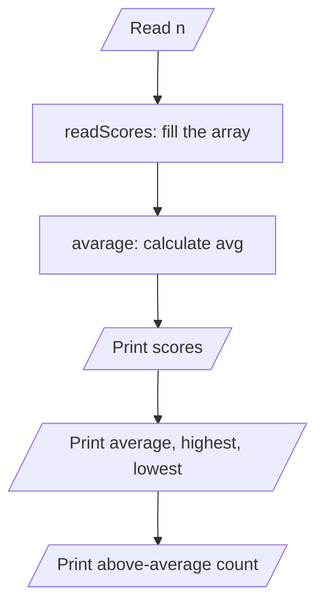

# Grade Analyzer

A beginner-friendly console program written in Java. It reads the grades of any number of students into an array, checks that every grade is valid, and then reports the average, the highest grade, the lowest grade, and how many students scored above the average. The whole program is built from small, single-purpose methods.

## Table of Contents

- [Purpose and Intended Users](#purpose-and-intended-users)
- [Requirements](#requirements)
- [Setup and Run](#setup-and-run)
- [How the Program Works](#how-the-program-works)
- [Example Input and Output](#example-input-and-output)
- [Invalid Grades](#invalid-grades)
- [Common Problems](#common-problems)
- [Limitations](#limitations)
- [Try It Yourself](#try-it-yourself)
- [Help and Contributions](#help-and-contributions)

## Purpose and Intended Users

**Problem:** After an exam, a teacher or a student often wants a quick summary of the results: what was the class average, who scored highest and lowest, and how many people did better than average. Doing this by hand is slow and error-prone.

**What it can do:**

- Ask how many students there are.
- Read one grade per student (0 to 100) and store them in an array.
- Reject grades outside the 0-100 range and ask again until a valid grade is entered.
- Print all grades, the average, the highest grade, the lowest grade, and the number of grades above the average.

**Who it is for:**

- Beginner Java students who want a worked example of **arrays**, **methods** (parameters and return values), **loops**, and **`Scanner` input**.
- Anyone who wants a short example of splitting a program into small methods instead of putting everything in `main`.

## Requirements

Before you start, make sure you have:

| Requirement | Details |
|---|---|
| Java Development Kit (JDK) | Version 11 or newer. The program was tested with JDK 21. |
| Source file | [`GradeAnalyzer.java`](GradeAnalyzer.java) |
| A terminal or an IDE | Any terminal (PowerShell, Command Prompt, Bash) or an IDE such as Apache NetBeans |

To check that Java is installed, run:

```powershell
java -version
javac -version
```

Both commands should print a version number. If one of them says the command is not found, see [Common Problems](#common-problems).

## Setup and Run

### Option 1: Command line

**Starting point:** open a terminal in the folder that contains `GradeAnalyzer.java`.

1. Compile the program:

   ```powershell
   javac GradeAnalyzer.java
   ```

2. Run it:

   ```powershell
   java GradeAnalyzer
   ```

3. Answer the questions: first the number of students, then one grade per student. Press Enter after each number.

**Expected result:** the program prints the list of grades followed by four statistics (average, highest, lowest, above average), and then stops.

### Option 2: Apache NetBeans

1. Create a new Java project (for example `GradeAnalyzer`).
2. Copy the code from [`GradeAnalyzer.java`](GradeAnalyzer.java) into the main class. Keep the class name and the file name the same.
3. Click **Run Project** (or press `F6`).
4. Type your input in the **Output** window at the bottom and press Enter after each number.

> **Note:** the class name and the file name must match exactly (`GradeAnalyzer` and `GradeAnalyzer.java`). If you rename the class, rename the file and the `java` command too.

## How the Program Works

`main` only organizes the work. Each task is done by its own method:

| Method | What it does | Returns |
|---|---|---|
| `readScores(Scanner input, int n)` | Creates an array of size `n`, reads `n` grades, and asks again for any grade outside 0-100 | `int[]` (the grades) |
| `avarage(int[] grades)` | Adds all grades and divides the sum by the number of grades | `double` |
| `max(int[] grades)` | Finds the largest grade | `int` |
| `min(int[] grades)` | Finds the smallest grade | `int` |
| `countAbove(int[] grades, double avarage)` | Counts the grades that are strictly greater than the average | `int` |
| `printScore(int[] grades)` | Prints all grades on one line, separated by spaces | nothing (`void`) |

**Flow of `main`:**

1. Read the number of students `n`.
2. Call `readScores` to fill the array `grades`.
3. Call `avarage` once and keep the result in the variable `avg`, so it is reused instead of recalculated.
4. Print the grades, then the average, highest, lowest, and above-average count.



**Design notes:**

- `max` and `min` start from `grades[0]` (not from `0`). Starting `min` at `0` would always report `0`, even when every grade is higher.
- The sum is stored in a `double`, so the average keeps its decimal part. Dividing two `int` values would silently drop it (`7 / 2` gives `3`).
- The array is created inside `readScores` and returned. A variable created inside one method cannot be seen by another method, so `main` receives the array through the return value and passes it on to the other methods as a parameter.
- The same `Scanner` object is created once in `main` and passed to `readScores`.

## Example Input and Output

**Start:** run the program as described in [Setup and Run](#setup-and-run).

**Input and output** (the numbers after the colons are typed by the user):

```text
How many students? 4
Enter score 1: 85
Enter score 2: 120
Invalid score, try again.
Enter score 2: 92
Enter score 3: 70
Enter score 4: 64

Scores: 85 92 70 64 
Average: 77.75
Highest: 92
Lowest: 64
Above average: 2
```

**How to check the result:**

| Statistic | Calculation | Result |
|---|---|---|
| Average | (85 + 92 + 70 + 64) / 4 = 311 / 4 | 77.75 |
| Highest | the largest of 85, 92, 70, 64 | 92 |
| Lowest | the smallest of 85, 92, 70, 64 | 64 |
| Above average | grades greater than 77.75: 85 and 92 | 2 |

The first attempt for student 2 (`120`) was rejected, so it is **not** part of the calculation. Only the accepted grade `92` was stored. If your output matches, the program works correctly.

**More examples:**

| Input (n, then grades) | Average | Highest | Lowest | Above average |
|---|---|---|---|---|
| `1`, `75` | 75.00 | 75 | 75 | 0 |
| `3`, `80`, `80`, `80` | 80.00 | 80 | 80 | 0 |
| `3`, `50`, `60`, `70` | 60.00 | 70 | 50 | 1 |

When every grade is equal, nobody is **above** the average, because `countAbove` uses a strict "greater than" comparison.

## Invalid Grades

A valid grade is a whole number from **0 to 100**, including both ends.

If a grade is below 0 or above 100, the program prints `Invalid score, try again.` and asks for the **same student's** grade again. This repeats until a valid grade is entered. The invalid value is never stored in the array, and the program does not move on to the next student until the current grade is valid.

```text
Enter score 1: -5
Invalid score, try again.
Enter score 1: 101
Invalid score, try again.
Enter score 1: 50
```

This is done with a `do-while` loop: the grade is read first, and the loop repeats **while the grade is invalid**.

## Common Problems

| Problem | Cause | Fix |
|---|---|---|
| `'javac' is not recognized` or `command not found` | The JDK is not installed, or it is not on your `PATH`. A JRE alone does not include `javac`. | Install a JDK, reopen the terminal, and run `javac -version` again. |
| `Could not find or load main class GradeAnalyzer` | You are in the wrong folder, or the program was not compiled. | Use `cd` to go to the folder with the file, run `javac GradeAnalyzer.java`, then run `java GradeAnalyzer` (without `.java` or `.class`). |
| The program appears to wait and prints nothing new | It is waiting for the next number. | Check the last prompt on the screen, type the number it asks for, and press Enter. |
| `Exception in thread "main" java.util.InputMismatchException` | A decimal number (like `85.5`) or text (like `abc`) was entered. | Restart the program and use whole numbers only, such as `85`. |
| `Exception in thread "main" java.lang.ArrayIndexOutOfBoundsException` right after entering `0` students | With zero students, the array is empty, so `max` and `min` cannot read `grades[0]`. | Restart and enter at least `1` student. |
| `Exception in thread "main" java.lang.NegativeArraySizeException` | A negative number of students was entered. | Restart and enter a positive whole number. |
| Prompts and answers look squeezed on one line when input is piped from a file | The prompts use `print`, and piped input has no visible Enter key presses. | This only affects redirected input. In a normal terminal each typed answer ends with Enter and the display is clean. |

## Limitations

**Current limitations**

- **Whole numbers only.** Grades are read as `int`. Decimal grades (such as `85.5`) and text stop the program with an `InputMismatchException`.
- **The number of students is not validated.** `0` or a negative number causes a runtime error instead of a friendly message.
- **Only the grade range is validated.** The range 0-100 is checked, but the type of the input is not.
- **Console only.** There is no file input or graphical interface.

**Out of scope** (not part of this program's goal)

- **No saved history.** The program does not store results between runs or write them to a file.
- **No student names.** Grades are identified only by their position (student 1, student 2, and so on).
- **No letter grades or ranking.**

**Possible future improvements** (not implemented yet)

- Validate the number of students and ask again for invalid values.
- Accept decimal grades by using `double`.
- Print the median and the standard deviation.
- Sort the grades with a method such as `sortedCopy` (bubble sort) without changing the original array.
- Rename `avarage` to `average` (spelling fix).

## Try It Yourself

**Recall:** Why does `max` start with `grades[0]` instead of `0`?

> **Answer:** Starting at `0` works for `max` only if at least one grade is above `0`, but it breaks `min` completely: the smallest value would stay `0` even if every grade is higher. Using the first element of the array as the starting value is correct for any data, because the real answer is always one of the array's elements.

**Apply:** What does the program print for `Above average` if the grades are `60`, `70`, `80`, `90`?

> **Answer:** The average is `(60 + 70 + 80 + 90) / 4 = 75.0`. Grades above 75 are `80` and `90`, so the output is `Above average: 2`.

**Explain:** Why is the array created inside `readScores` and not in `main`?

> **Answer:** A variable exists only inside the method where it is declared. If the array were created in `main`, `readScores` could not see it unless it was passed in as a parameter. Creating it inside `readScores` and returning it with `return grades;` gives `main` the finished array, which `main` then passes to the other methods.

## Help and Contributions

**Need help or found a problem?**

1. Check the existing issues before opening a new one.
2. If you open an issue, include:
   - the input you entered,
   - the expected result,
   - the actual result,
   - the exact error message.

**Want to improve the project?**

1. Work on a branch, or fork the repository if needed.
2. Make a small change and test it.
3. Update this README if the behavior changes, then commit and push.
4. Open a pull request and respond to feedback.

Clearer explanations are valuable contributions too. If a step in this guide was confusing, please suggest a better wording.
