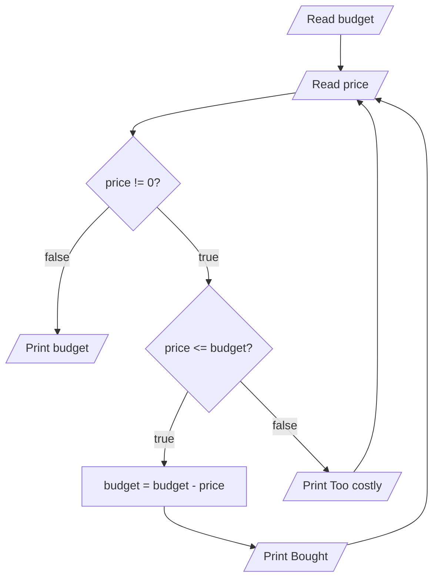

# Budgeted Shopping

A small console program written in Java that helps you stay within a budget while shopping. You enter your budget, then enter the price of each item one by one. The program buys an item only if you can afford it, and tells you how much money is left when you finish.

## Table of Contents

- [Purpose and Intended Users](#purpose-and-intended-users)
- [Requirements](#requirements)
- [Setup and Run](#setup-and-run)
- [How the Program Works](#how-the-program-works)
- [Example Input and Output](#example-input-and-output)
- [What Happens If Costs Exceed the Budget](#what-happens-if-costs-exceed-the-budget)
- [Common Problems](#common-problems)
- [Limitations](#limitations)
- [Help and Contributions](#help-and-contributions)

## Purpose and Intended Users

**Problem:** When we shop, it is easy to lose track of how much money we have left. This program keeps that running total for us and refuses any purchase that is more than the remaining budget.

**What it can do:**

- Read a starting budget.
- Read item prices until the user enters `0`.
- Accept an item if its price is less than or equal to the remaining budget, and subtract the price.
- Reject an item that costs more than the remaining budget.
- Print the remaining budget at the end.

**Who it is for:**

- Beginner Java students practicing `Scanner`, `while` loops, and `if/else` decisions.
- Anyone who wants a simple example of a sentinel-controlled loop (a loop that ends when a special value, here `0`, is entered).

## Requirements

Before you start, make sure you have:

| Requirement | Details |
|---|---|
| Java Development Kit (JDK) | Version 11 or newer. The program was tested with JDK 21. |
| Source file | [`BudgetedShopping.java`](BudgetedShopping.java) |
| A terminal or an IDE | Any terminal (PowerShell, Command Prompt, Bash) or an IDE such as Apache NetBeans |

To check that Java is installed, run:

```powershell
java -version
javac -version
```

Both commands should print a version number. If one of them says the command is not found, see [Common Problems](#common-problems).

## Setup and Run

### Option 1: Command line

**Starting point:** open a terminal in the folder that contains `BudgetedShopping.java`.

1. Compile the program:

   ```powershell
   javac BudgetedShopping.java
   ```

2. Run it:

   ```powershell
   java BudgetedShopping
   ```

3. Type the budget and press Enter, then type each price (one per line) and press Enter. Enter `0` to finish.

**Expected result:** for every price you enter, the program prints either `Bought` or `Too costly`. After you enter `0`, it prints the remaining budget and stops.

### Option 2: Apache NetBeans

1. Create a new Java project (for example `BudgetedShopping`).
2. Copy the code from [`BudgetedShopping.java`](BudgetedShopping.java) into the main class.
3. Click **Run Project** (or press `F6`).
4. Type your input in the **Output** window at the bottom, then press Enter after each number.

### The source code

```java
import java.util.Scanner;

public class BudgetedShopping {
    public static void main(String[] args) {
        Scanner input = new Scanner(System.in);
        int budget = input.nextInt();
        int price = input.nextInt();
        while (price != 0) {
            if (price <= budget) {
                budget = budget - price;
                System.out.println("Bought");
            } else {
                System.out.println("Too costly");
            }
            price = input.nextInt();
        }
        System.out.println(budget);
    }
}
```

> **Note:** the program does not print any prompt such as "Enter your budget". It simply waits for numbers. This is normal (see [Common Problems](#common-problems)).

## How the Program Works

1. Read the budget.
2. Read the first price.
3. While the price is not `0`:
   - If the price is less than or equal to the budget, subtract it from the budget and print `Bought`.
   - Otherwise, print `Too costly` and leave the budget unchanged.
   - Read the next price.
4. When `0` is entered, print the remaining budget.



## Example Input and Output

**Start:** run the program as described in [Setup and Run](#setup-and-run).

**Input** (one number per line):

```text
100
30
50
40
0
```

**Output:**

```text
Bought
Bought
Too costly
20
```

**How to check the result:**

| Step | Price | Budget before | Decision | Budget after |
|---|---|---|---|---|
| 1 | 30 | 100 | 30 <= 100, so `Bought` | 70 |
| 2 | 50 | 70 | 50 <= 70, so `Bought` | 20 |
| 3 | 40 | 20 | 40 > 20, so `Too costly` | 20 |
| 4 | 0 | 20 | Sentinel value, the loop ends | 20 |

The last line printed (`20`) is the remaining budget. If your output matches, the program works correctly.

You can also type all numbers on one line separated by spaces (`100 30 50 40 0`). `Scanner` accepts both styles.

## What Happens If Costs Exceed the Budget

The program never lets the budget go below zero through a normal purchase. The rule is:

> An item is bought only if `price <= budget`. If `price > budget`, the program prints `Too costly`, skips the item, and keeps the budget as it is.

A rejected item does **not** stop the program. You can keep entering prices, and a cheaper item can still be bought afterwards.

**Example 1: the first item is already too expensive**

```text
Input:   50, 80, 0
Output:  Too costly
         50
```

**Example 2: spending the budget exactly**

```text
Input:   20, 20, 5, 0
Output:  Bought
         Too costly
         0
```

The first `20` is accepted because `20 <= 20`, which leaves a budget of `0`. After that, every positive price is more than the budget, so the next item (`5`) is rejected.

**Example 3: no items at all**

```text
Input:   100, 0
Output:  100
```

Entering `0` as the first price ends the program immediately and prints the unchanged budget.

## Common Problems

| Problem | Cause | Fix |
|---|---|---|
| `'javac' is not recognized` or `command not found` | The JDK is not installed, or it is not on your `PATH`. A JRE alone does not include `javac`. | Install a JDK, reopen the terminal, and run `javac -version` again. |
| `Could not find or load main class BudgetedShopping` | You are in the wrong folder, or the program was not compiled. | Use `cd` to go to the folder with the file, run `javac BudgetedShopping.java`, then run `java BudgetedShopping` (without `.java` or `.class`). |
| `file not found: BudgetedShopping.java` | The filename or folder is wrong. | Check the spelling and capital letters. The file name must match the class name exactly. |
| The program appears to wait and prints nothing | It is waiting for input. The program has no prompts. | Enter the budget first, then prices. Enter `0` to finish. |
| `Exception in thread "main" java.util.InputMismatchException` | A decimal number (like `12.5`) or text was entered. | Restart the program and use whole numbers only, such as `30`. |
| `Exception in thread "main" java.util.NoSuchElementException` | The input ended before a `0` was entered. | Always finish the list of prices with `0`. |

## Limitations

**Current limitations**

- **Whole numbers only.** The program reads `int` values. Decimal amounts (such as `12.5`) and text cause an `InputMismatchException`, and the program stops.
- **No checks for negative values.** A negative price is accepted, because `-30 <= budget` is always true. It then increases the budget. For example, with a budget of `100`, entering `-30` and then `0` prints `Bought` and `130`. A negative starting budget is also not checked.
- **No prompts.** The program does not tell the user what to type.

**Out of scope** (not part of this program's goal)

- **No saved history.** The program does not keep a list of bought items or save anything to a file. Its aim is only to solve the budget problem.
- **No item names.** Only prices are used.

**Possible future improvements** (not implemented yet)

- Add messages that ask for the budget and each price.
- Reject negative numbers and ask again.
- Support decimal prices with `double`.
- Count and print the number of bought items.

## Help and Contributions

**Need help or found a problem?**

1. Check the existing issues before opening a new one.
2. If you open an issue, include:
   - the input you entered,
   - the expected result,
   - the actual result,
   - the exact error message.

**Want to improve the project?**

1. Work on a branch, or fork the repository if needed.
2. Make a small change and test it.
3. Update this README if the behavior changes, then commit and push.
4. Open a pull request and respond to feedback.

Clearer explanations are valuable contributions too. If a step in this guide was confusing, please suggest a better wording.
